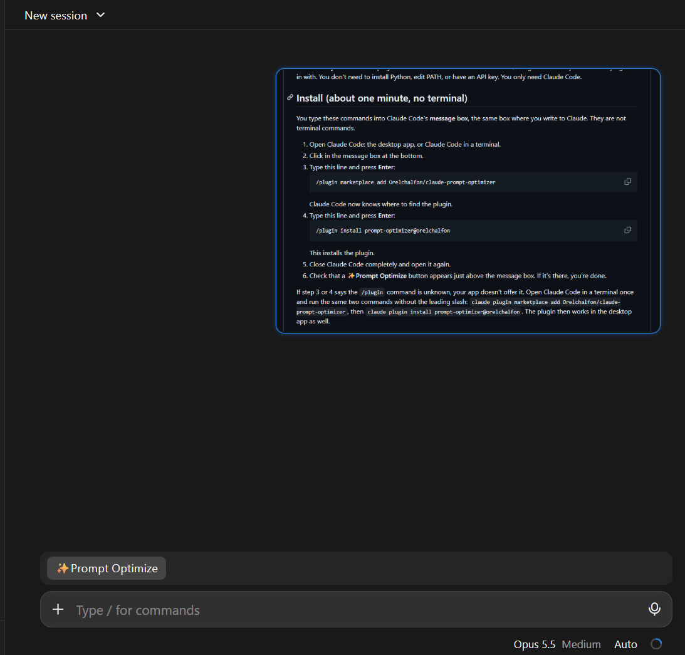

# prompt-optimizer

Turns a rough prompt into a sharp one before Claude acts on it. A small, fast Claude model (Haiku)
rewrites your prompt into a structured spec: **Title**, **Role & stance**, **Task**, **Context**,
**Inputs available**, **Output requirements**, **Constraints / Do-nots**, **Examples / References**,
**Execution checklist** and, when needed, **Conflict resolution**. It keeps your language (Hebrew stays
Hebrew, English stays English). If your prompt is too vague, it first asks a few checkbox questions and
uses your answers.

**Do I need Python? No.** The plugin asks Claude Code itself to do the rewrite, using the account you are
already signed in with. You don't need to install Python, edit PATH, or have an API key. You only need Claude Code.

## Install (about one minute, no terminal)

You type these commands into Claude Code's **message box**, the same box where you write to Claude. They
are not terminal commands.

1. Open Claude Code: the desktop app, or Claude Code in a terminal.
2. Click in the message box at the bottom.
3. Type this line and press **Enter**:
   ```
   /plugin marketplace add Orelchalfon/claude-prompt-optimizer
   ```
   Claude Code now knows where to find the plugin.
4. Type this line and press **Enter**:
   ```
   /plugin install prompt-optimizer@orelchalfon
   ```
   This installs the plugin.
5. Close Claude Code completely and open it again.
6. Check that a **✨Prompt Optimize** button appears just above the message box. If it's there, you're done.



[Watch a short demo](docs/demo.mp4)

If step 3 or 4 says the `/plugin` command is unknown, your app doesn't offer it. Open Claude Code in a
terminal once and run the same two commands without the leading slash:
`claude plugin marketplace add Orelchalfon/claude-prompt-optimizer`, then
`claude plugin install prompt-optimizer@orelchalfon`. The plugin then works in the desktop app as well.

## Use it

You can use it in any of three ways.

1. **The button.** Type a rough prompt in the message box (don't send it), click **✨Prompt Optimize**,
   read the improved prompt that replaces your text, then press **Enter** to send it.
2. **`--opt` at the end.** Type `fix the login bug --opt` and press **Enter**. Claude receives the
   improved prompt instead of what you typed. A short message confirms "✨ Prompt optimized".
   `~opt fix the login bug` (with `~opt` at the start) does the same.
3. **The command.** Type `/prompt-optimizer:opt fix the login bug` and press **Enter**. Claude shows
   the improved prompt and then carries it out.

The rewrite takes a few seconds. If it fails (no network, not signed in), your prompt is sent as you
typed it, without the `--opt`, and a short message says why. A prompt is never blocked.

**Modes** (for option 2): `--opt=egm` always starts the prompt with an EGM workflow command,
`--opt=code` never does, and `--opt=agent` adds a reminder to run review subagents. See [Modes](#modes).

## Update or remove

1. **Update:** type `/plugin marketplace update orelchalfon` in the message box, press **Enter**, then
   restart Claude Code.
2. **Remove:** type `/plugin uninstall prompt-optimizer@orelchalfon`, press **Enter**, then restart
   Claude Code.

## What it does on your computer

- **Network:** each rewrite is one call to a Claude model, through your own Claude Code sign-in. It
  counts toward your Claude usage, like any message.
- **Files:** none. The plugin reads its own `prompt.json` and writes nothing.
- **Programs:** none. Version 0.2.0 changed this: earlier versions ran Python (`optimizer.py`) for every
  rewrite. The plugin no longer uses Python at all.

---

## Optional: the terminal tool for other AI tools (needs Python)

`optimize.sh` / `optimize.ps1` print an optimized prompt in any terminal, for tools such as `codex` or
`agy`. This part, and only this part, needs Python 3. Skip it if you only use Claude Code.

```bash
git clone https://github.com/Orelchalfon/claude-prompt-optimizer
cd claude-prompt-optimizer
./optimize.sh "add google login to the sign-in screen"            # Git Bash, macOS, Linux
./optimize.sh --mode egm --clip "design a billing service"
echo "תוסיף כפתור התחברות עם גוגל" | ./optimize.sh
```

```powershell
.\optimize.ps1 "add google login to the sign-in screen" --clip
```

The default (`claude`) backend uses only Python's standard library, so there's nothing to `pip install`.
The wrappers use `.venv` if the folder has one, otherwise the system `python3` / `python`. The `api`
backend also needs the `anthropic` package: `python -m venv .venv`, then
`.venv/Scripts/pip install -r requirements.txt` (Unix: `.venv/bin/pip`).

| Backend | How it calls the model | Needs |
| --- | --- | --- |
| `claude` | Runs the Claude Code CLI headless (`claude -p --model haiku`, no tools) | `claude` on PATH and signed in |
| `api` | Calls the Anthropic API with the `anthropic` SDK (pay per use) | `ANTHROPIC_API_KEY` |

`auto` (the default) uses `api` when `ANTHROPIC_API_KEY` is set and `claude` otherwise.

| Variable | Default | Meaning |
| --- | --- | --- |
| `PROMPT_OPTIMIZER_BACKEND` | `auto` | `auto`, `claude` or `api`. Also `--backend`. |
| `PROMPT_OPTIMIZER_MODEL` | `haiku` (`claude`), `claude-3-5-haiku-latest` (`api`) | Model that rewrites the prompt. |
| `ANTHROPIC_API_KEY` | none | Only for the `api` backend. |

On the `claude` backend the child Claude Code process runs in the temp folder with your settings, hooks,
plugins and slash commands turned off, and the call is not saved as a session. On the `api` backend, if
the default model no longer exists, the optimizer retries once with `claude-haiku-5-5`.

The optimized prompt is the only thing on stdout; notes and errors go to stderr. Exit code is 0 on
success, 1 on a failure, 2 on wrong usage. `optimize.ps1` waits for standard input to close when a
launcher leaves it open; from such a launcher use `optimize.sh` or redirect stdin.

### `/opt` without the plugin

`setup.sh` installs the command as plain `/opt` (it runs `optimize.sh`, so it needs Python):

```bash
bash setup.sh                                  # this project only
bash setup.sh --target ~/.claude/commands      # every project
```

`--remove` deletes the file it wrote. Start a new Claude Code session, then type
`/opt add google login to the sign-in screen`.

### Settings-hook alternative

If you don't want the plugin, `hooks/hook_runner.py` speaks the classic `UserPromptSubmit` protocol (needs
Python). A settings hook can't replace a prompt, so the optimized prompt is attached as context the agent
is told to follow. Use this or the plugin, not both:

```json
{
  "hooks": {
    "UserPromptSubmit": [
      { "hooks": [{ "type": "command", "timeout": 60,
        "command": "python \"<folder>/hooks/hook_runner.py\"" }] }
    ]
  }
}
```

## Modes

| Mode | Behavior |
| --- | --- |
| `auto` (default) | The model decides whether an EGM command or the subagent reminder applies. |
| `egm` | The result always opens with exactly one of `/egm:egm-brainstorm`, `/egm:egm-draft`, `/egm:egm-review`. |
| `code` | Implementation spec; never opens with an EGM command. |
| `agent` | Always ends with the reminder to run the `copywriter` and `qa` subagents via `run_subagent.py`. |

In `auto`: brainstorm or explore ideas → `/egm:egm-brainstorm`; design a complex new system →
`/egm:egm-draft`; audit or check existing code or designs → `/egm:egm-review`; UI or marketing text, or
implementation in a multi-agent workspace → the subagent reminder. When the optimized prompt opens with
an EGM command, it doesn't run as a slash command; the agent reads it as an instruction to use that skill.

The button is drawn in the band above the message box because Claude Code has no plugin slot next to `+`.
On an app that doesn't share the draft with plugins, the button says "No draft to optimize"; use `--opt` there.

## Files

| File | Purpose |
| --- | --- |
| `prompt.json` | The rewrite instructions and mode rules, shared by the plugin and the Python tool. |
| `hooks/optimize.ts` | The plugin's engine: triggers, modes, and the model call through Claude Code. |
| `hooks/register.tsx`, `hooks/hooks.json`, `.claude-plugin/plugin.json` | The plugin: the button, `--opt` / `~opt`, and `/prompt-optimizer:opt`. |
| `.claude-plugin/marketplace.json` | Makes this repo a marketplace, so `/plugin install` works. |
| `commands/opt.md`, `setup.sh` | The `/opt` command and its installer. |
| `optimizer.py`, `hooks/hook_runner.py`, `optimize.sh`, `optimize.ps1` | The Python terminal tool and settings hook. |
| `tests/test_optimizer.py`, `hooks/register.test.tsx` | Tests. |

## Tests

```bash
python -m pytest                 # 57 tests of the Python tool, model calls mocked, no network
python -m ruff check .
claude plugin validate .
claude plugin test .             # 6 tests of the plugin, model calls mocked
```

## License

MIT. See `LICENSE`.
